<!-- scan:ok -->

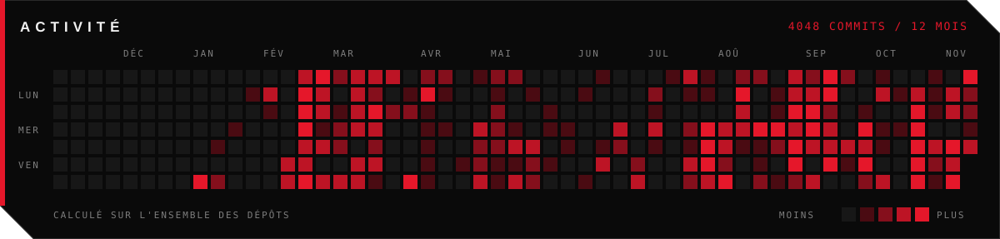
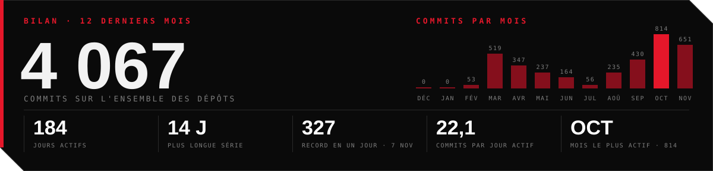

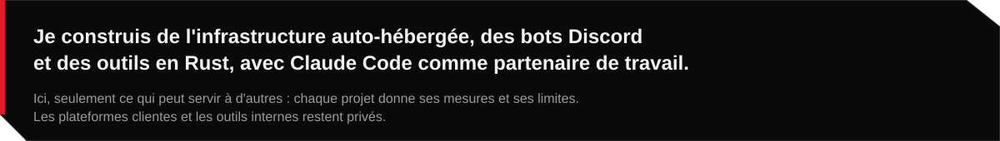

 

<a href="https://github.com/TojiiSamaa/herdr-mcp-rust">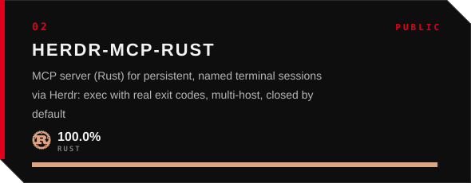</a><!-- scan:ok -->
<a href="https://github.com/TojiiSamaa/mcp-arr-rust">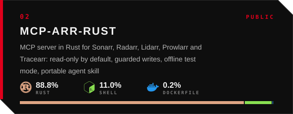</a><!-- scan:ok -->
<a href="https://github.com/TojiiSamaa/Home-Assistant-MCP-Rust">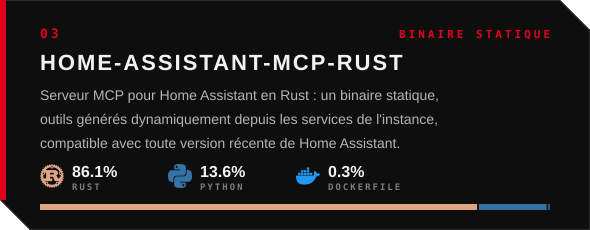</a><!-- scan:ok -->
<a href="https://github.com/TojiiSamaa/anime4k-rust">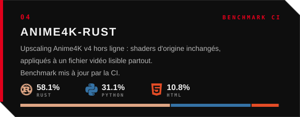</a><!-- scan:ok -->
<a href="https://github.com/TojiiSamaa/studio-creation">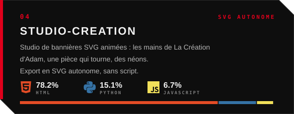</a><!-- scan:ok -->
<a href="https://github.com/TojiiSamaa/laya-benchmark">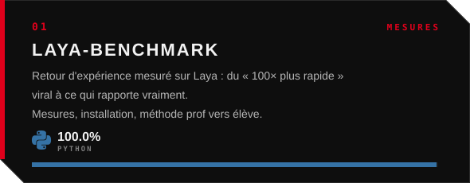</a><!-- scan:ok -->

<a href="https://github.com/TojiiSamaa/github-mcp-server-rust">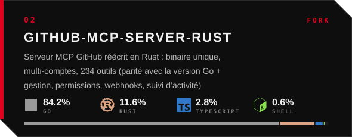</a><!-- scan:ok -->
<a href="https://github.com/TojiiSamaa/opnmcp-rust">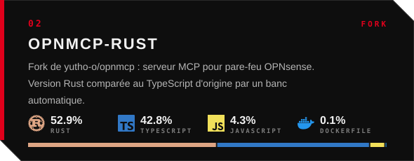</a><!-- scan:ok -->
<a href="https://github.com/TojiiSamaa/netbox-mcp-rust">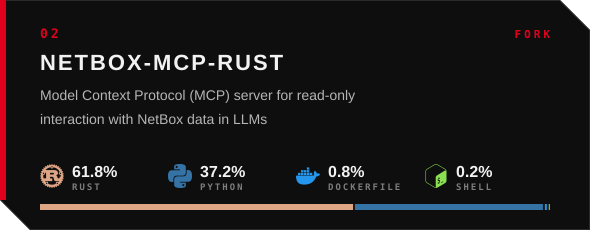</a><!-- scan:ok -->
<a href="https://github.com/TojiiSamaa/Kotbo">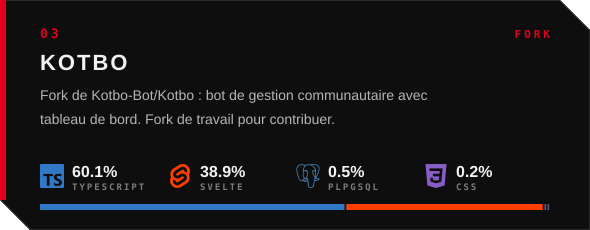</a><!-- scan:ok -->
<a href="https://github.com/TojiiSamaa/Anime4K">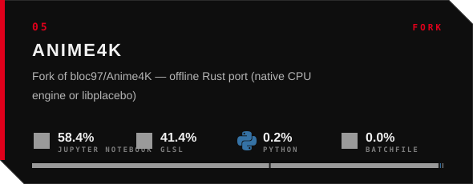</a><!-- scan:ok -->
<a href="https://github.com/TojiiSamaa/vibeMK">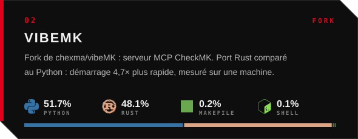</a><!-- scan:ok -->
<a href="https://github.com/TojiiSamaa/SocialVideoDownload.py">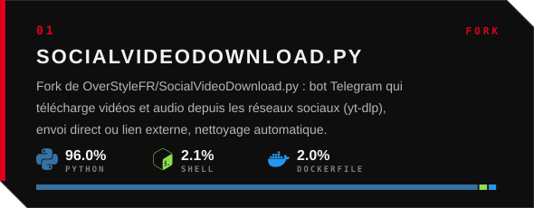</a><!-- scan:ok -->
<a href="https://github.com/TojiiSamaa/capri-web-rust">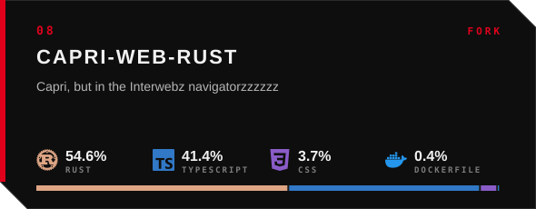</a><!-- scan:ok -->

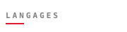 <a href="https://nodejs.org">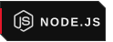</a>  
   
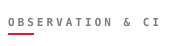  
 <a href="https://ollama.com">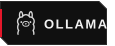</a> 


