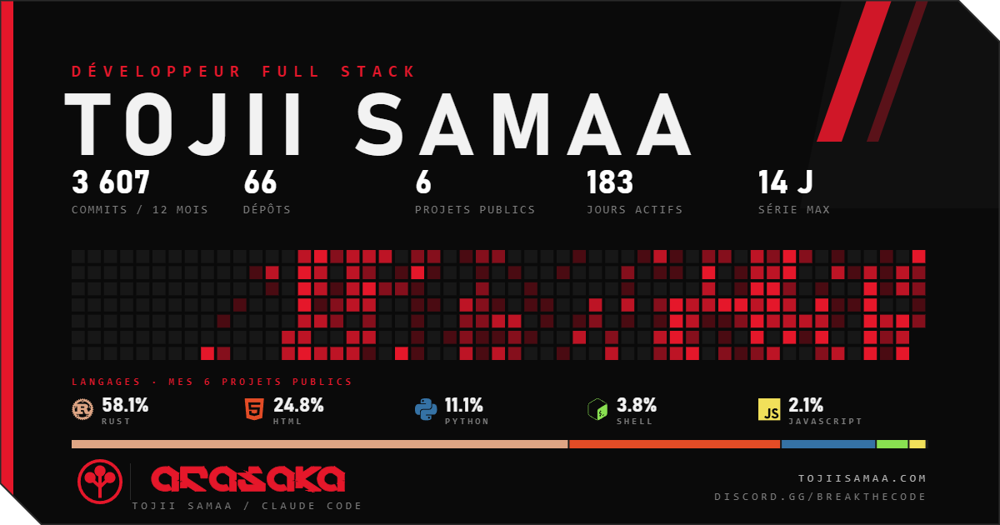

<!-- scan:ok -->

Développeur full stack. Projets publics en Rust, Python et JavaScript : Home Assistant réécrit en Rust, upscaling Anime4K, studio de bannières SVG animées. Communauté : Break The Code.
Le graphique et les chiffres sont recalculés chaque jour.
